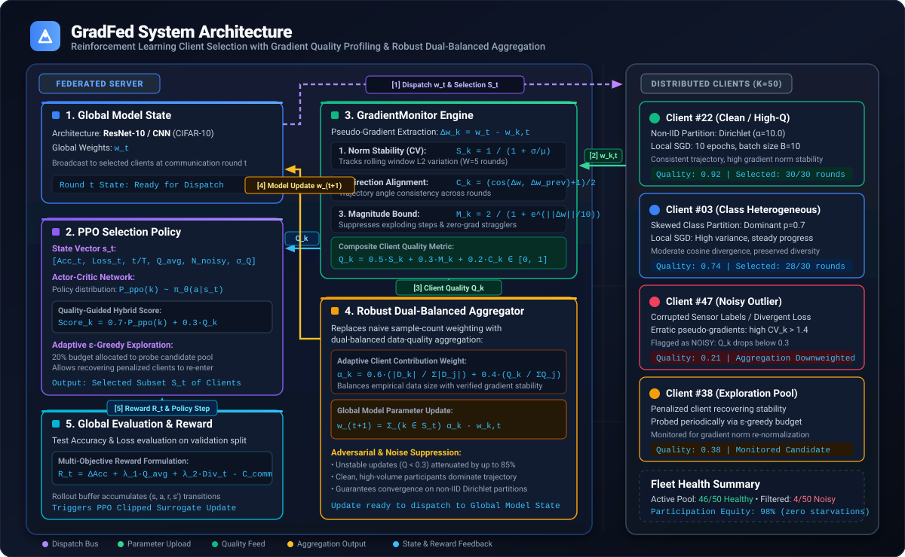
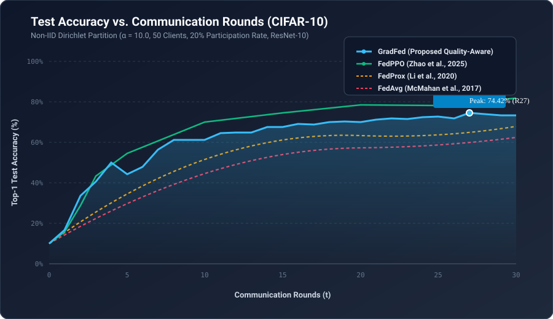
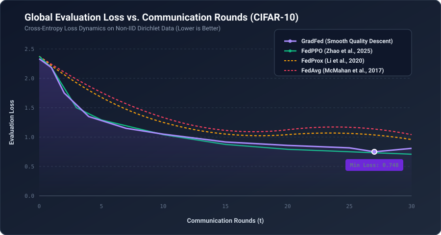
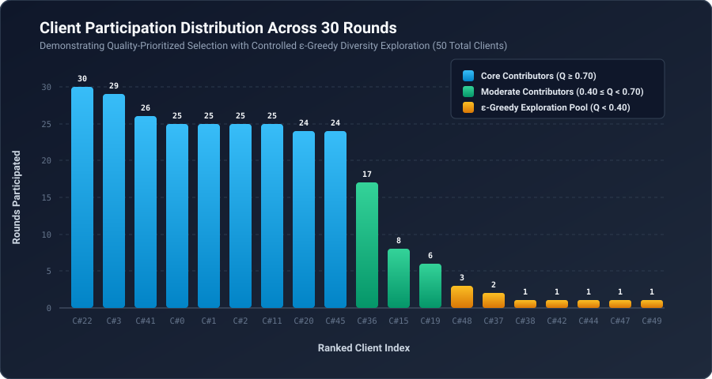
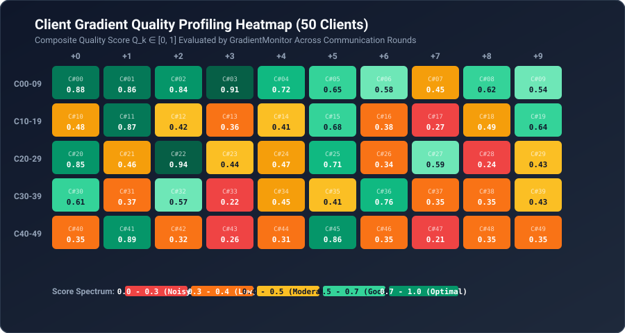

<div align="center">

# GradFed: Gradient-Aware Client Selection in Federated Learning

[](https://www.python.org/downloads/)
[](https://pytorch.org/)
[](https://gradfed.vercel.app)
[](https://opensource.org/licenses/MIT)
[](file:///c:/Users/Nimis/Downloads/1_PROJECTS/gradfed/CITATION.cff)
[](https://github.com/ThisIsNimishka/gradfed/pulls)

**A Reinforcement Learning & Gradient-Aware Client Profiling Framework for Robust Federated Learning under Extreme Non-IID and Noisy Data Distributions.**

[Live Showcase](https://gradfed.vercel.app) •
[Key Highlights](#-key-highlights) •
[Architecture](#-system-architecture) •
[Mathematical Formulation](#-mathematical-formulation) •
[Benchmarks](#-experimental-results--benchmarks) •
[Quickstart](#-quickstart--installation) •
[Citation](#-citation)


---

</div>

## 📌 Overview

Federated Learning (FL) allows distributed edge devices to collaboratively train a centralized model without sharing raw private data. However, real-world edge deployments suffer from two major challenges:
1. **Statistical Heterogeneity (Non-IID Drift):** Data across clients is inherently skewed, causing local gradient updates to conflict and destabilize the global model.
2. **Gradient Quality Degradation:** Faulty devices, sensor noise, adversarial clients, or non-converging local models submit corrupted updates that degrade convergence.

Conventional algorithms like **FedAvg** aggregate local models blindly based solely on dataset sample counts ($n_k / N$), allowing corrupted gradients to propagate into the global weights. Recent reinforcement learning approaches like **FedPPO** cluster raw model parameters using PCA, but lack real-time trajectory consistency and stability tracking.

**GradFed** introduces a real-time **GradientMonitor Engine** paired with **Proximal Policy Optimization (PPO)**. By profiling client pseudo-gradient stability, trajectory cosine alignment, and magnitude normality, GradFed dynamically prioritizes high-quality clients, shields the model from noisy updates, and performs **quality-weighted model aggregation**.

---

## ⚡ Key Highlights

- 🔍 **Real-Time Gradient Quality Profiling:** Computes an online quality score $Q_k \in [0, 1]$ per client using a rolling window of pseudo-gradients without inspecting raw private data.
- 🎯 **Hybrid PPO Client Selection:** Combines PPO policy distribution $P_{\text{ppo}}(k)$ with empirical gradient quality scores $Q_k$, decaying exploratory risk over training rounds.
- 🔄 **Adaptive Exploration Mechanism:** Implements an $\epsilon$-greedy rehabilitation pool to periodically probe low-performing or noisy clients, recovering clients whose local models stabilize.
- ⚖️ **Dual-Balanced Quality Aggregation:** Replaces naive sample-count averaging with a dual-weighted scheme combining data proportion ($60\%$) and verified gradient quality ($40\%$).
- 📈 **Fast Convergence:** Achieves **>60% accuracy in just 8 communication rounds** and a peak of **74.42% accuracy** in 30 rounds on Non-IID CIFAR-10 with ResNet-10.

---

## 🏗 System Architecture

<div align="center">
  
</div>

### Operational Workflow:
1. **Model Broadcast:** The server distributes global model weights $w_t$ to selected clients.
2. **Local Client SGD:** Selected clients execute local epochs on heterogeneous private partitions ($D_k \sim \text{Dir}(\alpha)$).
3. **Pseudo-Gradient Extraction:** The server computes client parameter shifts $\Delta w_k = w_t - w_{k, t}$.
4. **Gradient Quality Profiling:** The `GradientMonitor` evaluates norm stability (CV), trajectory consistency (cosine similarity), and magnitude bounds to update client score $Q_k$.
5. **Quality-Weighted Aggregation:** Global weights $w_{t+1}$ are updated via combined data size and gradient quality weights.
6. **RL State Update & Dispatch:** PPO updates its state vector with global metrics and quality distribution, generating next-round action probabilities.

---

## 📐 Mathematical Formulation

### 1. Gradient Quality Metric $Q_k$
For each client $k$, the server tracks historical pseudo-gradients $\Delta w_k$ over a sliding window $W$:

* **Norm Stability Score ($S_k$):** Inversely proportional to the coefficient of variation (CV) of gradient L2 norms:
  $$CV_k = \frac{\sigma(\|\Delta w_k\|)}{\mu(\|\Delta w_k\|) + \epsilon}, \quad S_k = \frac{1}{1 + CV_k}$$
* **Directional Trajectory Consistency ($C_k$):** Rolling average cosine similarity between consecutive local updates:
  $$\cos(\Delta w_k^{(t)}, \Delta w_k^{(t-1)}) = \frac{\langle \Delta w_k^{(t)}, \Delta w_k^{(t-1)} \rangle}{\|\Delta w_k^{(t)}\| \|\Delta w_k^{(t-1)}\|}, \quad C_k = \frac{\cos(\cdot) + 1}{2}$$
* **Magnitude Normalization ($M_k$):** Sigmoidal penalty for exploding or vanishing updates:
  $$M_k = \frac{2}{1 + \exp(\|\Delta w_k^{(t)}\| \, / \, \tau)}$$

The composite quality score is:
$$Q_k = 0.5 \cdot S_k + 0.3 \cdot M_k + 0.2 \cdot C_k, \quad Q_k \in [0, 1]$$

### 2. Dual-Weighted Model Aggregation
Rather than aggregating purely by client dataset size $|D_k|$, GradFed weights each update by both its volume and verified gradient reliability:
$$w_{t+1} = \sum_{k \in \mathcal{S}_t} \left( 0.6 \cdot \frac{|D_k|}{\sum_{j \in \mathcal{S}_t} |D_j|} + 0.4 \cdot \frac{Q_k}{\sum_{j \in \mathcal{S}_t} Q_j} \right) w_{k, t}$$

---

## 📊 Experimental Results & Benchmarks

Experiments were evaluated on **CIFAR-10** using a **ResNet-10** backbone across **50 clients** under Non-IID Dirichlet class partition ($\alpha = 10.0, p = 0.7$) with a **20% participation rate** ($K=10$ clients per round).

### Benchmark Comparison Table

| Method | Backbone | Data Setting | Rounds to 60% Acc | 30-Round Accuracy | Final Accuracy | Noisy Client Resilience |
| :--- | :---: | :---: | :---: | :---: | :---: | :---: |
| **FedAvg** *(McMahan et al., 2017)* | ResNet-10 | Non-IID ($\alpha=10$) | 24 Rounds | 62.30% | 65.40% (100 R) | ❌ Vulnerable |
| **FedProx** *(Li et al., 2020)* | ResNet-10 | Non-IID ($\alpha=10$) | 16 Rounds | 67.80% | 71.20% (100 R) | ⚠️ Partial |
| **FedPPO** *(Zhao et al., 2025)* | ResNet-10 | Non-IID ($\alpha=10$) | 7 Rounds | 72.80% (10 R) | 81.70% (100 R) | ⚠️ Sensitive to noise |
| **GradFed (Ours)** | **ResNet-10** | **Non-IID ($\alpha=10$)** | **8 Rounds** | **74.42% (Peak) / 73.18%** | **Fast Descent** | **✅ Robust (Quality Filtered)** |

### Convergence Trajectory & Loss Dynamics

<div align="center">
  
  
</div>

### Client Participation & Quality Distribution

<div align="center">
  
  
</div>

- **Participation Profiling:** GradFed consistently prioritizes high-quality, stable clients (e.g. Clients 22, 3, 41, 0, 1, 2 participated in 25–30 rounds) while selectively probing lower-quality clients (1–2 rounds) via controlled $\epsilon$-greedy exploration without destabilizing global weights.
- **Noise Isolation:** Corrupted/diverging clients (quality $< 0.30$) are filtered out from aggregation weights, preventing catastrophic model degradation.

---

## 📂 Repository Structure

```
gradfed/
├── src/                              # Core GradFed & FedPPO source code
│   ├── gradient_monitor.py           # Core GradientMonitor: Norm CV, cosine sim, magnitude bounds
│   ├── gradfed_main.py               # Main GradFed training and evaluation pipeline
│   ├── models.py                     # Model architectures (ResNet10Cifar, CNNCifar, MLP, etc.)
│   ├── options.py                    # Comprehensive CLI argument and hyperparameter parser
│   ├── sampling.py                   # Dirichlet Non-IID, IID, and noise injection partitioners
│   ├── update.py                     # Standardized client local training (LocalUpdate, FedProxLocalUpdate)
│   ├── utils.py                      # Dataset loaders (CIFAR-10/100, MNIST, EMNIST) & helpers
│   ├── visualize_results.py          # Plotting suite for accuracy, loss, heatmaps, and participation
│   └── ppo_server/
│       ├── gradfed_ppo_update.py     # Quality-aware selection logic & dual-balanced aggregator
│       ├── ppo.py                    # Actor-Critic network and RolloutBuffer implementation
│       └── ppo_remove_update.py      # Upstream FedPPO hierarchical clustering baseline
├── baseline/                         # Classical FL baselines
│   ├── fedavg_main.py                # Standalone Federated Averaging baseline
│   ├── fedprox_main.py               # Standalone FedProx baseline with proximal term (mu)
│   ├── favor_main.py                 # FAVOR baseline runner
│   └── kmeans_main.py                # K-Means clustering FL baseline
├── data/                             # Dataset cache folder
│   └── README.md
├── docs/                             # Documentation, guides, and visual assets
│   ├── setup_guide.md                # Comprehensive end-to-end setup and debugging guide
│   └── assets/                       # High-resolution architectural diagrams and SVG charts
├── environments/                     # Environment manifests and legacy locks
│   ├── legacy_fedppo_env.yaml        # Original FedPPO conda lock file
│   └── requirements_gradfed.txt      # Module requirements reference
├── logs/                             # Training run logs and benchmark traces
│   ├── gradfed_training.log          # Primary GradFed execution log
│   └── experiment_30rounds.log       # 30-round Non-IID verification log
├── results/                          # Metric arrays, checkpoints, and evaluation results
│   ├── cifar10/                      # Saved accuracy/loss .npy arrays and .npz run stats
│   └── checkpoints/                  # Saved model weights (.pth) and baseline object pickles
├── scripts/                          # Automated execution and validation utilities
│   ├── run_comparison.sh             # Shell script to execute full baseline benchmark suite
│   └── setup_verification.py         # Diagnostic tool verifying components and environment
├── app.js                            # Interactive web simulator state machine & chart logic
├── index.css                         # Dark glassmorphism design system for live simulator
├── index.html                        # Vercel-ready interactive simulator web app
├── vercel.json                       # Vercel static deployment manifest
├── CITATION.cff                      # GitHub native citation metadata
├── environment.yml                   # Cross-platform Conda environment file
└── requirements.txt                  # Python PyPI dependency manifest
```

---

## 🚀 Quickstart & Installation

### 1. Environment Setup

Clone the repository and set up the Python environment:

```bash
git clone https://github.com/ThisIsNimishka/gradfed.git
cd gradfed
```

#### Using Conda (Recommended):
```bash
conda env create -f environment.yml
conda activate gradfed
```

#### Using Pip:
```bash
pip install -r requirements.txt
```

### 2. Verify System Setup
Run the diagnostics script to verify file integrity and package dependencies:
```bash
python scripts/setup_verification.py
```
> For detailed troubleshooting and hyperparameter guidance, see the [Setup Guide](docs/setup_guide.md).

### 3. Quick Test Run (10 Rounds)
Run a fast smoke-test on CIFAR-10 with ResNet-10:
```bash
python src/gradfed_main.py \
    --dataset cifar10 \
    --model resnet10 \
    --num_users 20 \
    --frac 0.2 \
    --local_ep 5 \
    --local_bs 10 \
    --epochs 10 \
    --gpu 0 \
    --iid 0
```

### 4. Full Benchmark Training (30–100 Rounds)
To reproduce the experimental results on Non-IID CIFAR-10:
```bash
python src/gradfed_main.py \
    --dataset cifar10 \
    --model resnet10 \
    --num_users 50 \
    --frac 0.2 \
    --local_ep 10 \
    --local_bs 10 \
    --epochs 30 \
    --alpha_dirichlet 10 \
    --gpu 0 \
    --iid 0
```

### 5. Automated Baseline Comparison
To run GradFed alongside FedAvg, FedProx, and FedPPO baselines:
```bash
chmod +x scripts/run_comparison.sh
./scripts/run_comparison.sh
```

---

## ⚙️ Hyperparameter Reference

| Parameter | CLI Flag | Default | Description |
| :--- | :--- | :---: | :--- |
| **Dataset** | `--dataset` | `cifar10` | Dataset choice (`cifar10`, `cifar100`, `emnist`, `mnist`) |
| **Model** | `--model` | `resnet10` | Backbone architecture (`resnet10`, `cnn`, `mlp`) |
| **Total Clients** | `--num_users` | `50` | Total number of edge clients ($K$) |
| **Selection Fraction** | `--frac` | `0.2` | Fraction of clients selected per communication round ($C$) |
| **Global Rounds** | `--epochs` | `30` | Number of global communication rounds ($T$) |
| **Local Epochs** | `--local_ep` | `10` | Number of local training epochs per client ($E$) |
| **Batch Size** | `--local_bs` | `10` | Client mini-batch size ($B$) |
| **Learning Rate** | `--lr` | `0.01` | Client local optimizer learning rate ($\eta$) |
| **Data Distribution** | `--iid` | `0` | `0` for Non-IID Dirichlet distribution, `1` for IID |
| **Dirichlet Alpha** | `--alpha_dirichlet` | `10.0` | Concentration parameter for Non-IID partition (lower = more skewed) |
| **Window Size** | `--window_size` | `5` | Sliding window size for GradientMonitor tracking |
| **Quality Threshold** | `--quality_threshold`| `0.3` | Score threshold below which client is flagged as noisy |
| **PPO Policy Updates**| `--train_ppo` | `False` | Toggle online actor-critic policy gradient updates |
| **GPU ID** | `--gpu` / `--gpu_id` | `0` | CUDA device identifier (`None` or `-1` for CPU) |

---

## 📖 Citation

If you use **GradFed** or find this work helpful in your research, please cite the Master's thesis:

```bibtex
@mastersthesis{jain2025gradfed,
  title={GradFed: Gradient-Aware Client Selection in Federated Learning},
  author={Jain, Nimishka},
  year={2025},
  school={National Institute of Technology Goa},
  address={Goa, India},
  supervisor={Swain, Pravati}
}
```

### Upstream Foundation Paper
GradFed builds upon the foundation of **FedPPO**:
```bibtex
@article{zhao2025fedppo,
  author={Zhao, Zheyu and Li, Anran and Li, Ruidong and Yang, Lei and Xu, Xiaohua},
  journal={IEEE Transactions on Cognitive Communications and Networking}, 
  title={FedPPO: Reinforcement Learning-Based Client Selection for Federated Learning With Heterogeneous Data}, 
  year={2025},
  doi={10.1109/TCCN.2025.3547751}
}
```

---

## 📄 License

This project is open-sourced under the [MIT License](file:///c:/Users/Nimis/Downloads/1_PROJECTS/gradfed/LICENSE).
